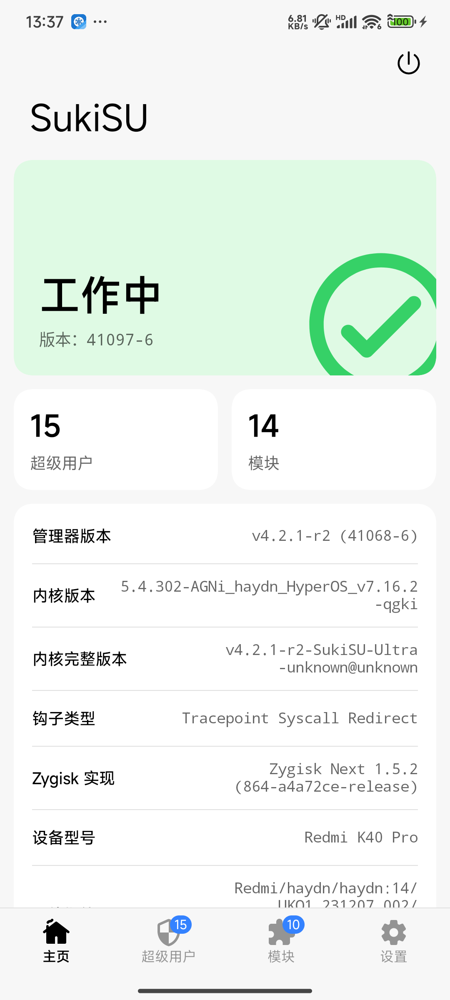
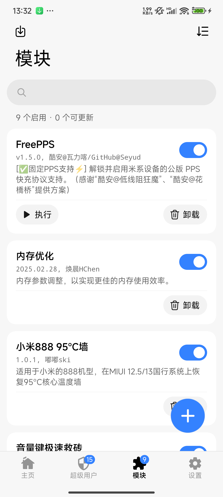

# Redmi K40 Pro (haydn) — SukiSU-Ultra 移植记录

> 目标设备：Redmi K40 Pro / M2012K11C / haydn，HyperOS OS1.0.15.0.UKKCNXM（Android 14）
> 状态：**已适配成功，日常可用** —— SukiSU-Ultra v4.2.1-r2 (41097-6) 跑在 5.4.302-AGNi 上

| | |
|---|---|
|  |  |

管理器和内核都正常识别，Zygisk Next 工作，模块可装。

## 快速开始

**方式一：GitHub Actions 一键构建**
Actions → `build-haydn-sukisu` → Run workflow，选 `main` 模式，跑完下载 `Image` 产物。

**方式二：本地构建**（已验证：WSL2 Ubuntu + clang-18，约 19 分钟）

```bash
git clone --depth=1 -b AGNi_haydn_MIUI_ST https://github.com/psndna88/AGNi_pureMIUI.git kernel
cd kernel && rm -rf drivers/kernelsu KernelSU
curl -LSs https://raw.githubusercontent.com/SukiSU-Ultra/SukiSU-Ultra/main/kernel/setup.sh | bash -s main
cd .. && bash scripts/patch-all-5.4.sh ./kernel        # 5.4 兼容补丁，不跑编译不过
cd kernel && make ARCH=arm64 O=out CC=clang LD=ld.lld ... && cd ..
```

**打包 + 刷入**（无需 magiskboot / root）

```bash
python scripts/repack-boot-local.py Image boot_a_dump.img boot_new.img
bash scripts/flash-boot-safe.sh boot_new.img          # 自带 A/B 防切槽
```

刷完 **必须** 装一次 appid 持久化脚本，否则管理器会显示"不支持/预览模式"：

```bash
adb push scripts/ksu-manager-appid.sh /data/local/tmp/x.sh
adb shell "su -c 'cp /data/local/tmp/x.sh /data/adb/service.d/10-ksu-manager-appid.sh;
  chown root:root /data/adb/service.d/10-ksu-manager-appid.sh;
  chmod 755 /data/adb/service.d/10-ksu-manager-appid.sh'"
```

细节和踩坑过程见第七~十一章。

## 脚本清单

| 脚本 | 作用 |
|---|---|
| `scripts/patch-all-5.4.sh` | **核心**：8 处零散兼容 + SELinux 子系统 + defconfig，幂等 |
| `scripts/patch-sukisu-5.4.py` | SELinux policydb 原地改写、filename_trans、appid 参数常开 |
| `scripts/repack-boot-local.py` | 纯 Python 重打包 boot header v3（AVB footer 大端） |
| `scripts/flash-boot-safe.sh` | 防 A/B 自动切槽的刷入 |
| `scripts/ksu-manager-appid.sh` | 经 `service.d` 持久化 `ksu_manager_appid` |
| `scripts/wsl-build.sh` | 完整一键构建（WSL2 路径硬编码） |
| `scripts/rebuild.sh` / `build-clean.sh` | 增量 / 全量重编 |
| `scripts/probe_ksu.c` | aarch64 静态探针，验证 fd + GET_INFO 链路 |

---

## 一、诊断结论（实测，不是猜）

| 项目 | 实测值 |
|---|---|
| 机型 / 代号 | M2012K11C / haydn，A/B 分区，当前 slot **a** |
| 系统 | HyperOS **OS1.0.15.0.UKKCNXM**，Android 14，`UKQ1.231207.002` |
| 内核 | `5.4.259-vk-neo-g9a1f4f78`，2024-07-11 构建，Ubuntu clang 14.0.0 |
| 内核来源 | **VK 内核（The Voyager）**，卡刷包 `Voyager-haydn-ksu-build-10-MIUI_HOS-11.07.24.zip`（还在 /sdcard 根目录） |
| 当前 root 驱动 | **KernelSU-Next 1.0.5**（`su -v` = `1.0.5:KernelSU`，ksud 1.0.5） |
| SukiSU 管理器 | 已装 **v4.1.2**，但内核里没有 SukiSU 驱动 → 装了等于没装 |
| vendor 模块 | `/vendor/lib/modules` 共 112 个，vermagic `5.4.274-qgki-gcc3ec22f5061`，**当前内核一个都没加载**（驱动基本全编进内核） |
| boot 镜像 | header v3，kernel 原始未压缩 48.9 MB，ramdisk gzip 52 MB，OS patch 2025-02 |
| kprobe 能力 | `CONFIG_KPROBES/ КRETPROBES/ HAVE_SYSCALL_TRACEPOINTS/ KPROBE_EVENTS` **全部为 y** |

### 为什么 SukiSU 现在用不起来

1. SukiSU 是 KernelSU 的分支，**管理器必须配自己家的内核驱动**。你内核里是 KernelSU-Next 的驱动，所以 SukiSU 管理器只能装着。
2. 你的内核是 **5.4（non-GKI 2.0）**，SukiSU 官方文档写明：KPROBES 方式只保证 5.10+；5.4 要用 `builtin` 分支 + 手动 hook。但——
3. **实测你这颗内核开了 KRETPROBES 和 sys_enter tracepoint**，而 SukiSU `main` 分支的 hook 管理器正是靠这两样工作（代码里没有 `LINUX_VERSION_CODE` 硬门槛）。所以 5.4 上跑 `main` 分支（纯 kprobe，不改内核源码）是可行的。
4. 真正卡住的不是技术，而是**没有 Linux 编译环境**：本机 WSL 被安全策略拉黑，也没 Docker。

### 已经完成的备份（重要）

| 文件 | 说明 |
|---|---|
| `boot_a_dump.img` (192 MB) | boot_a 分区原始完整镜像（dd 出来的，含当前 VK 内核），**变砖就刷它** |
| `vk_kernel.img` (48.9 MB) | 从 boot_a 解出来的当前内核本体，用于比对 |

> 注意：`ro.boot.flash.locked=1`、`verifiedbootstate=green` 是 VK 内核自己改 cmdline 伪装出来的，实际 BL 已解锁（否则刷不进第三方内核）。

---

## 二、两条路线

### 路线 A（推荐）：AGNi 5.4.302 树 + SukiSU v4.2.1-r2 `main` 分支

**为什么选这棵树**
- `psndna88/AGNi_pureMIUI` 分支 `AGNi_haydn_MIUI_ST`，内核 **5.4.302**，仓库描述明确支持 **MIUI 13/14 + HyperOS | AOSP A13/A14**，2026-08 还在更新。
- `agni_haydn_defconfig` 里 **WLAN / CNSS2 / QCA_CLD_WLAN 全是 `=y`（编进内核）**，`anykernel.sh` 里 `do.modules=0` —— 说明它跟你的现状一样**不依赖 vendor 模块**，只换 boot 里的 kernel 就能跑。
- 这棵树自带 KernelSU 手动 hook 和 SUSFS 开关，后续加 SUSFS 有现成基础。

**代价**：SukiSU `main` 分支**不带 SUSFS**。要 SUSFS 必须走 `builtin` 分支 + 手动 hook 移植（见路线 B）。

### 路线 B（二期）：`builtin` + SUSFS

AGNi 源码里的 hook 是按 KernelSU-Next 的 API 写的，换成 SukiSU `builtin` 需要改这几处：

| 文件 | 现状（KSU-Next） | SukiSU builtin 对应 |
|---|---|---|
| `fs/exec.c` | `ksu_handle_execveat()` / `ksu_handle_execveat_sucompat()` | 同名，**签名兼容** ✅ |
| `fs/open.c` | `ksu_handle_faccessat()` | 同名同签名 ✅ |
| `kernel/sys.c` | `ksu_handle_setresuid()` | builtin 里改由 `hook/lsm_hook.c` 接管 ❌ 需处理 |
| `fs/*` | `susfs_is_current_proc_umounted()` | `susfs_extension.c` 只提供 `susfs_set_*`，**缺 is_** ❌ 需补 |
| defconfig | `CONFIG_KSU_MANUAL_HOOK=y` | builtin 分支已无此选项（自动启用）⚠️ |

结论：二期不是"开个开关"，要改 3~5 处源码并反复编译验证。**先把一期跑通再上**。

---

## 三、执行步骤（路线 A）

### 1. 建 GitHub 仓库跑编译（不需要本机 Linux）

```bash
# 在 GitHub 新建一个空仓库（private 也行），然后把本目录推上去
git init
git add .
git commit -m "haydn sukisu build kit"
git branch -M main
git remote add origin https://github.com/<你的账号>/<仓库名>.git
git push -u origin main
```

推送后到仓库 **Actions → build-haydn-sukisu → Run workflow**：
- `sukisu_ref`：留空 = 最新（当前 `v4.2.1-r2`）
- 跑完在 Artifacts 下载 `Image`（约 40~50 MB）

编译机规格：ubuntu-22.04 / 4 核 / clang-14（和你现役内核同版本编译器），耗时约 40~80 分钟。

### 2. 用新内核重打包 boot 并刷入

```bash
# 1) 把 Image 推进设备，用设备上的 magiskboot 重打包（保留原 ramdisk）
bash scripts/pack-boot.sh Image

# 2) 确认生成了 new-boot.img 后刷入（BL 已解锁）
bash scripts/flash-boot.sh new-boot.img
```

### 3. 安装管理器

编译出的驱动是 SukiSU 内核侧，管理器装 **SukiSU-Ultra v4.2.1-r2**（当前 v4.1.2 可直接覆盖升级）：

```
https://github.com/SukiSU-Ultra/SukiSU-Ultra/releases/latest
```

打开后首页应显示 `SukiSU: 工作中` + 版本号，而不是"未安装"。

### 4. 翻车回滚（30 秒）

```bash
adb reboot bootloader
fastboot flash boot_a boot_a_dump.img
fastboot reboot
```

或者进 TWRP 把 `boot_a_dump.img` 刷到 Boot 分区。

---

## 四、风险清单

1. **首次开机可能循环重启**：AGNi 5.4.302 比你系统的 5.4.274 新，个别驱动（相机/指纹）可能需要调 defconfig。回滚即可，不会变砖（boot 有备份）。
2. **WiFi / 基带异常**：AGNi 把 WLAN/CNSS 编进内核，正常不会；若异常说明该树与 OS1.0.15 vendor 有差异，需要换 `AGNi_haydn_MIUI_S_OLD2` 或 VK 源码试。
3. **AVB / 校验**：小米 A/B 机型刷 boot 不改 vbmeta，一般直接能开机；若报 `dm-verity` 错误，`fastboot --disable-verity --disable-verification flash vbmeta_a ...`（本方案默认不动 vbmeta）。
4. **OTA**：系统更新会覆盖 boot，root 失效只是掉 root，不会变砖。

---

## 五、本地编译（WSL）——当前实际在走的路

WSL 限制解除后改成本机编译，脚本：`scripts/wsl-build.sh`（同步到 WSL 的 `/root/build.sh`）。

```bash
# 在 Windows 里执行（同步脚本 + 启动编译）
wsl.exe -d Ubuntu-24.04 -u root -- bash -lc 'cat > /root/build.sh && chmod +x /root/build.sh' < scripts/wsl-build.sh
wsl.exe -d Ubuntu-24.04 -u root -- bash -lc 'bash /root/build.sh main > /root/run.out 2>&1'

# 只编译 kernelsu 子目录，快速验证补丁（几十秒）
wsl.exe -d Ubuntu-24.04 -u root -- bash /mnt/e/.../scripts/quick-ksu.sh
```

编译参数：clang-18 / llvm-18，`CROSS_COMPILE=aarch64-linux-gnu-`、`CROSS_COMPILE_COMPAT=arm-linux-gnueabi-`，12G swap。

### 5.4 内核适配补丁（SukiSU v4.2.1-r2 `main` 分支原本只保证 5.10+）

`scripts/patch-sukisu-5.4.py` 统一处理，幂等可重复执行（首次运行会把原文件备份成 `.orig`）：

| 文件 | 问题 | 处理 |
|---|---|---|
| `selinux/rules.c` | 5.4 没有 `struct selinux_policy`，policydb 内嵌在 `selinux_state.ss` 里 | `apply_kernelsu_rules` / `handle_sepolicy` 增加 5.4 分支：**原地改写 live policydb**，配 `policy_rwlock` + 绑核 + SCHED_FIFO 提优先级（沿用 KernelSU-Next 在 4.14~5.9 的成熟做法） |
| `selinux/sepolicy.c` | `ksu_dup_sepolicy` / `ksu_destroy_sepolicy` 依赖 5.7+ 的 policy 抽象 | 只在 `>= 5.10` 编译 |
| `selinux/sepolicy.c` | `filename_trans_key` / `trans->stypes` / `compat_filename_trans_count` 都是 5.7+ | `add_filename_trans` 增加 5.4 分支，改用老的 `struct filename_trans` + `filename_trans_ttypes` |
| `feature/selinux_hide.c` | 整个文件强依赖 5.7+ policy | 5.4 上降级为 no-op（只影响"隐藏痕迹"，不影响 root） |
| `supercall/supercall.c` 等 | `TWA_RESUME` 宏 5.9 才有 | 统一补 `#define TWA_RESUME true` |

另外 `wsl-build.sh` 4.5/7 段里还有一批零散补丁：`linux/pgtable.h`（5.8+）、`security_inode_init_security_anon`（5.10+）、`__p4d_to_phys`（5.10+）、seccomp filter cache（5.9+）、`pkg_observer` 的 fsnotify 新接口（5.9+）、`vdso_clock_mode`（5.5+）、`dispatch.c` 缺头文件等。

---

## 六、目录说明

```
.
├── README.md                     # 本文件
├── boot_a_dump.img               # boot_a 完整备份（务必保留，唯一救砖镜像）
├── vk_kernel.img                 # 原厂内核本体（分析用）
├── SukiSU_4.2.1.apk              # 正确的管理器（release 41068）
├── scripts/wsl-build.sh          # WSL 内完整编译流程（官方 setup.sh + 5.4 补丁）
├── scripts/patch-sukisu-5.4.py   # 5.4 兼容补丁（核心）
├── scripts/quick-ksu.sh          # 只编 kernelsu，快速验证
├── scripts/rebuild.sh            # 增量重编译
├── scripts/build-clean.sh        # 全量干净重编译
├── scripts/repack-boot-local.py  # 本地重打包 boot（无需 root/magiskboot）
├── scripts/flash-boot-safe.sh    # 刷入（自动检查/修正 A/B 槽位）
├── scripts/pack-boot.sh          # 设备端 magiskboot 重打包（需 root）
├── scripts/flash-boot.sh         # fastboot 刷入（简单版）
├── scripts/restore-boot.sh       # 回滚原厂 boot
└── .work/SukiSU-Ultra-builtin/   # SukiSU builtin 源码（二期移植参考）
```

---

## 七、刷机/救砖必读：A/B 自动切槽

**这是最容易把人搞崩的坑。** 内核连续 panic 后，小米 bootloader 会把 `current-slot` 从 `a` 自动切到 `b`。
此后你刷 `boot_a` 完全无效，现象是"连原厂 boot 都不开机了"，极容易误判成砖。

规则：

1. **每次刷之前、刷之后都确认槽位**
   ```bash
   fastboot getvar current-slot          # 必须是 a
   fastboot --set-active=a               # 不是 a 就切回来
   fastboot flash boot_a 
   fastboot getvar current-slot          # 再确认一次
   ```
   已封装：`bash scripts/flash-boot-safe.sh <boot.img>`

2. **Logo 循环时 USB 不枚举**，adb/fastboot 都看不到设备。必须手动：
   长按电源 10 秒关机 → 同时按住**音量下 + 电源** → 出现 `FASTBOOT` 字样才松手。

3. **救砖**：`fastboot --set-active=a` + `fastboot flash boot_a boot_a_dump.img`（原厂 `5.4.259-vk-neo`，实测必开）。

---

## 八、无 root 时如何重打包 boot

设备没有 root 时跑不了 `magiskboot`（`pack-boot.sh` 用不了）。改用纯 Python：

```bash
python scripts/repack-boot-local.py <Image> boot_a_dump.img boot_new.img
```

- boot header **v3** 布局：`[header 4096][kernel 页对齐][ramdisk 页对齐][AVB0 vbmeta 块][0 填充][AVB footer 64B]`
- **AVB footer 字段是大端**：`AVBf`(4) + ver_major(4) + ver_minor(4) + `original_image_size`(8) + `vbmeta_offset`(8) + `vbmeta_size`(8) + reserved(28)
- vbmeta 块大小实测 `0x380`(896B)，位置以镜像里真实的 `AVB0` 魔数为准
- 已用原厂内核做**恒等重打包验证：byte-identical（0 diff）**

> 注意：解锁状态下 AVB 不校验（原厂镜像的 footer 偏移本身就和实际 AVB0 位置差 4KB），所以自定义内核只需保证 header 里的 `kernel_size` 与 ramdisk 偏移正确。

---

## 九、管理器显示"未检测到 SukiSU 驱动 / 预览模式"

原因不是驱动没编进去，而是**管理器 appid 没被内核识别**，链路如下：

1. 管理器 native 层先扫 `/proc/self/fd` 找内核装的 anon-inode fd（readlink = `[ksu_driver]`），失败才退回 `prctl(0xDEADBEEF, 2, ...)` 老协议；本套内核**只有 fd+ioctl**，没有 prctl 处理器 → 返回 -1 → 显示"不支持"
2. fd 由内核在 `hook/setuid_hook.c` 里安装，条件是 `is_uid_manager(new_uid)` 为真
3. 该条件最终看 `ksu_manager_appid`，而它只能由 `track_throne(false)` 扫 `packages.list` + 校验 manager 签名来加冕
4. `track_throne(false)` 原本由 5.9+ 的 `pkg_observer`（fsnotify）触发；5.4 上被降级为 no-op，`on_boot_completed` 又只调 `track_throne(true)`（仅 prune）→ appid 恒为 -1

临时绕过（需要 root）：

```bash
# 先取管理器真实 uid
su -c 'dumpsys package com.sukisu.ultra | grep appId'   # -> appId=10303
# appid = uid % 100000，10303 -> 10303（不是 303！）
su -c 'echo 10303 > /sys/module/kernelsu/parameters/ksu_debug_manager_appid'
# 必须强杀重启管理器，让 zygote fork 时重新装 fd
am force-stop com.sukisu.ultra
```

> ⚠️ **最容易踩的坑**：Android 进程名 `u0_a303` 里的 303 是 `appId-10000`，
> 真实 uid 是 `10303`。`ksu_manager_uid_authorized()` 里做的是
> `appid == uid % KSU_PER_USER_RANGE`（100000），所以 appid 必须填 **10303**。
> 填 303 会写入成功但永远匹配不上，管理器依旧"不支持"。
>
> 验证成功的标志：
> - 管理器首页显示 **工作中**，内核版本 `41097-6`，钩子类型 `Tracepoint Syscall Redirect`
> - `ls -l /proc/$(pidof com.sukisu.ultra)/fd | grep ksu` → `anon_inode:[ksu_driver]`

`ksu_debug_manager_appid` 本来被 `CONFIG_KSU_DEBUG` 包着，`patch-sukisu-5.4.py` 的 `patch_debug_param()` 已把它改成常开；同时 `patch_boot_event()` 把 `on_boot_completed` 里的 `track_throne(true)` 在 5.4 上改成 `track_throne(false)`，使 appid 在 post-fs-data 阶段自动加冕，无需每次开机手写参数。

该函数由 `supercall/dispatch.c:157` 在 ksud 上报阶段触发，此时 `/data/system/packages.list` 可读（DE 存储，早于解锁），因此扫描能成功。


---

## 十、appid 持久化：不要改内核，用 service.d 脚本

### 失败尝试：改 `on_boot_completed` 的 `track_throne`

按源码分析，5.4 上唯一能自动加冕的位置是 `runtime/boot_event.c` 的 `on_boot_completed()`
（由 `supercall/dispatch.c:157` 在 ksud 上报阶段调用），把 `track_throne(true)` 改成
`track_throne(false)` 理论上可行。**实测刷入后无法开机**（卡住，槽位未切换 → 没走到 panic）。

产物保留：`boot_appid.img`（含 `KSU_PATCH_BOOT_EVENT=1`）。**不要再刷这个镜像。**

推测原因：`track_throne(false)` 在 appid 无效时会走完整路径——扫描 `/data/app`
并对每个候选 base.apk 做签名校验（`ksu_search_manager()`），在 post-fs-data 阶段
同步读取尚未完全就绪的 FBE 存储，导致长时间阻塞。要修正应改为
`schedule_delayed_work` 异步执行，未验证。

### 正确做法：`/data/adb/service.d/10-ksu-manager-appid.sh`

ksud 会执行 `/data/adb/post-fs-data.d` 与 `/data/adb/service.d` 里的脚本
（`ksud/src/init_event.rs` → `exec_common_scripts("{stage}.d")`）。
在 service 阶段把 appid 写进模块参数即可，**每次开机自动生效**，不动内核、零风险。

```bash
# 安装（宿主侧）
adb push scripts/ksu-manager-appid.sh /data/local/tmp/ksu-appid.sh
adb shell "su -c 'cp /data/local/tmp/ksu-appid.sh /data/adb/service.d/10-ksu-manager-appid.sh;
  chown root:root /data/adb/service.d/10-ksu-manager-appid.sh;
  chmod 755 /data/adb/service.d/10-ksu-manager-appid.sh;
  rm /data/local/tmp/ksu-appid.sh'"
# 上下文应为 u:object_r:adb_data_file:s0（目录默认标注即可，无需手工 chcon）
```

脚本逻辑：仅当参数为 `4294967295`/`-1` 时才写入；用 `dumpsys package` 取 `appId`
后 `% 100000`，取不到则兜底 `10303`。

---

## 十一、从 KernelSU-Next 迁移模块（modules.img）

上一套 KernelSU-Next 用 **module image** 存模块：`/data/adb/ksu/modules.img`
（1TiB 稀疏 ext4），`/data/adb/modules` 只是空挂载点。换成 SukiSU 后该镜像不会被挂载，
所以模块列表看起来「全没了」——实际都还在镜像里。

导出办法（读写挂载才能回放 ext4 日志，只读会报 `Read-only file system`）：

```bash
su -c 'mkdir -p /data/local/tmp/ksumod
       mount -o loop /data/adb/ksu/modules.img /data/local/tmp/ksumod
       for d in /data/local/tmp/ksumod/*; do n=$(basename $d);
         [ "$n" = lost+found ] || cp -a $d /data/adb/modules/; done
       umount /data/local/tmp/ksumod; rmdir /data/local/tmp/ksumod'
```

本机实测导出 13 个模块（`zygisksu`/`zygisk_lsposed`/`zygisk_shamiko`/`zygisk-sui`/
`FreePPS`/`MemoryOpt`/`RescueBrick`/`WorkSettingPro`/`original_temperature_threshold`/
`scene_swap_controller`/`scene_systemless`/`uperf`/`vx-tablet`），管理器识别到 9 个启用。
`modules.img` 原文件保持不动，可随时回退。

### 但模块仍不会生效：缺 metamodule

SukiSU 4.x 把模块 overlay 挂载交给 **metamodule**（`/data/adb/metamodule/`，
如 meta-overlayfs）。本机该目录不存在，`mount | grep adb/modules` 为空 ——
模块只是被列出，**系统文件替换没有真正挂载**。
需要在管理器「模块」页在线安装 metamodule（meta-overlayfs）后重启才会生效。

### 结论：装上 metamodule 后可以了

已装 `meta-overlayfs v1.3.1`（`KernelSU-Modules-Repo/meta-overlayfs`，
`ksud module install meta-overlayfs-13100-1.3.1.zip`，会自动建 2GB ext4 存储）。

装完后管理器显示 **模块 14、Zygisk 实现 Zygisk Next 1.5.2**，`ps` 里能看到
`zn-zygisk-companion64 zygisk-sui`。

**注意 `metamount.sh` 日志里的 `no content directory` 是正常的**：
`zygisksu`/`FreePPS`/`MemoryOpt`/`scene_*`/`uperf` 这些都是纯脚本型模块
（只有 `post-fs-data.sh`/`service.sh`/`bin/`，没有 `system/`），本来就不需要 overlay，
靠 ksud 执行脚本工作。只有真正替换系统文件的模块才需要内容目录。

`meta-overlayfs` 的双目录约定：元数据在 `/data/adb/modules/<id>/`，
overlay 内容在 `/data/adb/metamodule/mnt/<id>/`。本机模块都不涉及，故无影响。
